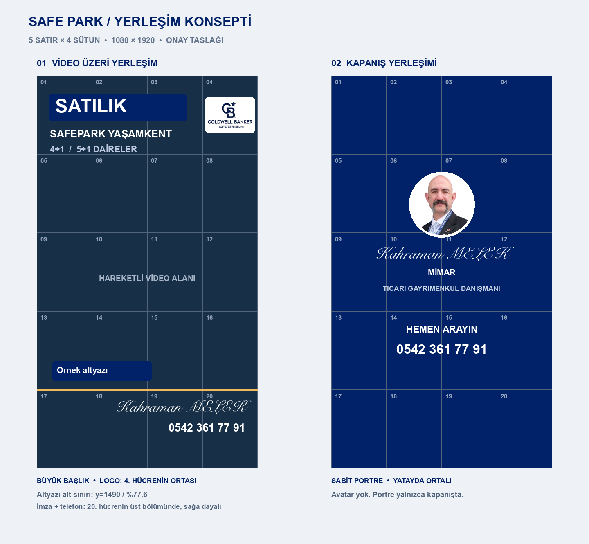

# chatgpt-sosyal-medya-kurgu-atolyesi

**Kahraman MELEK** için kişisel sosyal medya video kurgu atölyesi. Coldwell Banker Parla Gayrimenkul kimliğiyle Reels, Story, TikTok ve WhatsApp Durum için 1080×1920 dikey emlak videoları hazırlanır. ChatGPT/Codex ile kurgu planlama, FFmpeg ve mevcut Remotion araçlarıyla üretim için kaynakları içerir.

## Onaylı tasarım

5×4 grid, 1–20 hücre. Büyük başlık 1 numarasının altında; Parla Gayrimenkul logosu 4. hücrenin ortasında; altyazı 17. hücrenin üst sınırına yakın; imza ve telefon 20. hücrenin üst bölümünde sağa dayalı. Kapanışta sabit, ortalı gerçek portre. Avatar kullanılmaz.

- [Yerleşim kuralları](marka/sablonlar/README.md)
- [Ölçüler / JSON](marka/sablonlar/kahraman-melek-grid-v1.json)
- [Marka kimliği](marka/MARKA.md)
- [Çalışma talimatları](AGENTS.md)
- [Mevcut IlanReel rehberi](.claude/skills/video-kurgula/references/ilan-reel.md)

Bu sürüm onaylı tasarımı kaydeder. Mevcut IlanReel bileşenlerinin eski yerleşimi yeni şablona henüz uyarlanmadı; üretimden önce uyarlanıp kare üzerinden doğrulanmalıdır.

## Danışman

**Mimar Kahraman MELEK · Ticari Gayrimenkul Danışmanı**

Coldwell Banker Parla Gayrimenkul · **0542 361 77 91**

## Çalışma

Kaynak videoları proje klasöründe tut. Yeni yazı ve seslendirme metinlerini uygulamadan önce onay al. Orijinalleri ve önceki çıktı sürümlerini koru. Yerel API ayarları `.env` içinde kalır; medya, anahtarlar ve çalışma çıktıları Git’e eklenmez. FFmpeg/Node.js araçları kullanılır; Remotion gerektiğinde bağımlılıklar `package.json` üzerinden kurulur. Yalnızca tasarım kaydetmek için paket kurulumu gerekmez.

## Kaynak ve lisans

Onur Yıldırım’ın MIT lisanslı [Claude Kurgu Atölyesi](https://github.com/onuryildriim/claude-kurgu-atolyesi) projesinden türetilmiştir. Özgün yazarın telif bildirimi `LICENSE` içinde korunur. Kahraman MELEK’e özel dikey video tasarımı, marka dosyaları ve şablon bu kişisel sürüme aittir. Bağımlılıkların ve marka varlıklarının kendi kullanım koşulları geçerlidir.
